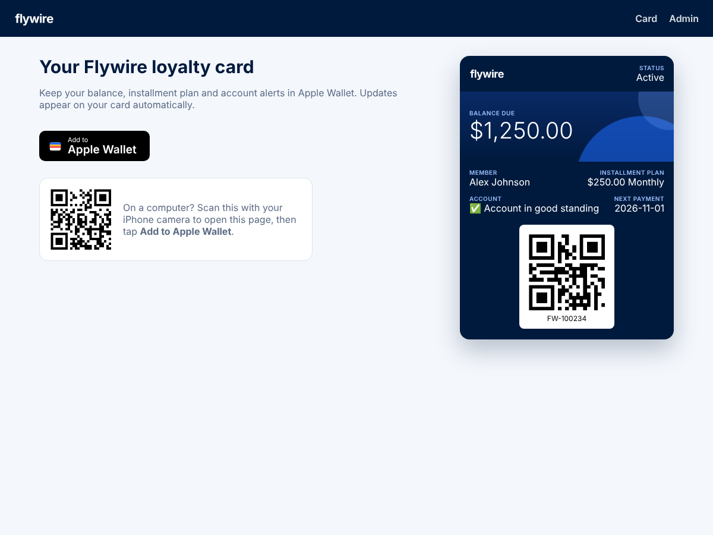
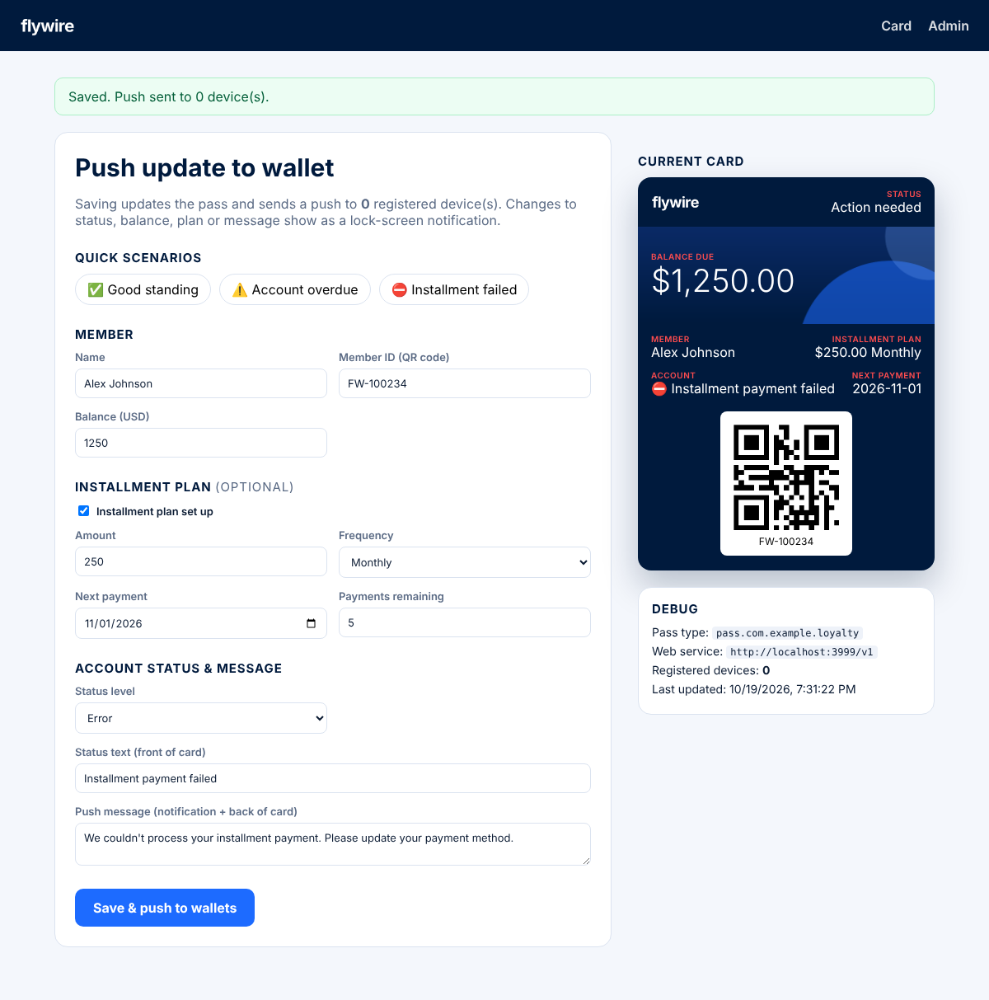

# Flywire Apple Wallet Loyalty Card (prototype)

A small Node.js app for Replit that issues **one** Apple Wallet loyalty card and lets an admin push live updates to it.

- **Home page** (`/`): card preview + **Add to Apple Wallet** button (and a QR code to open the page on your iPhone).
- **Admin page** (`/admin`): edit the balance, installment plan, account status and message, then **Save & push to wallets**. The card on the phone updates within seconds and shows a lock-screen notification.

| Home | Admin |
| --- | --- |
|  |  |

## What's on the pass

- **QR code** containing the member ID.
- **Live account info**: balance due, installment plan (optional: amount, frequency, next payment, payments remaining).
- **Warnings and errors**: status level `OK` / `Warning` / `Error` changes the header ("ACTIVE" / "WARNING" / "ACTION NEEDED"), the label colour (blue / amber / red) and the icon on the account line (✅ / ⚠️ / ⛔️). The admin page has one-click scenarios: *Good standing*, *Account overdue*, *Installment failed*.
- **Flywire branding**: navy and blue colour scheme, `flywire` logo, strip artwork.

> The logo in `assets/` is a placeholder text wordmark. To use the official Flywire logo, replace `assets/logo.png` (160×50), `logo@2x.png` (320×100) and `logo@3x.png` (480×150) with transparent PNGs, and `icon*.png` (29/58/87 px squares). Colours are set in `src/config.js` → `BRAND`.

---

## Setup (about 15 minutes)

### 1. Create a Pass Type ID and certificate (Apple Developer account)

1. Go to [Certificates, Identifiers & Profiles → Identifiers](https://developer.apple.com/account/resources/identifiers/list/passTypeId), click **+**, choose **Pass Type IDs**, and create one, e.g. `pass.com.yourcompany.loyalty`.
2. Open the new Pass Type ID and click **Create Certificate**. You'll need a CSR: on a Mac, open **Keychain Access → Certificate Assistant → Request a Certificate From a Certificate Authority** → "Saved to disk".
3. Download the `.cer`, double-click it to add it to Keychain, then in Keychain Access → *My Certificates* right-click **Pass Type ID: pass.com.yourcompany…** → **Export** as `pass.p12` and set a password.
4. Note your **Team ID** (top right of the developer portal, or Membership page).

### 2. Import into Replit

1. Create a new Repl → **Import from GitHub** → this repo (or upload the files).
2. Upload `pass.p12` into the `certs/` folder.
3. In the Replit **Shell**, run:
   ```bash
   P12_PASSWORD='the-password-you-set' npm run setup-certs
   ```
   This creates `certs/signerCert.pem`, `certs/signerKey.pem` and downloads Apple's `certs/wwdr.pem`. (`certs/` is git-ignored.)
4. Open **Tools → Secrets** and add:

   | Secret | Example | Notes |
   | --- | --- | --- |
   | `PASS_TYPE_ID` | `pass.com.yourcompany.loyalty` | Must match the certificate exactly |
   | `TEAM_ID` | `ABCDE12345` | Your Apple Team ID |
   | `ADMIN_PASSWORD` | `something-secret` | Password for `/admin` (any username). Defaults to `admin` |

   *Optional:* instead of files in `certs/`, you can put the PEMs in Secrets as `SIGNER_CERT`, `SIGNER_KEY`, `WWDR_CERT` (raw PEM or base64), plus `SIGNER_KEY_PASSPHRASE` if your key is encrypted.

### 3. Run

Click **Run**. Open the webview URL (`https://….replit.dev`) **on your iPhone in Safari** and tap **Add to Apple Wallet**.

Then open `/admin` on any device, change something, and click **Save & push to wallets**.

> **The pass remembers the URL it was downloaded from** and uses it for updates. The dev URL only works while the Repl is running. For something that stays up, **Deploy** it (Reserved VM is the simplest: it keeps `data.json` on disk), set the `PUBLIC_URL` secret to the deployment URL, delete the pass from your phone, and add it again from the deployed URL.

---

## How live updates work

```
Admin clicks Save ──► server saves data.json ──► APNs push (empty payload) ──► iPhone
iPhone ──► GET /v1/devices/…/registrations?passesUpdatedSince=…  ("what changed?")
iPhone ──► GET /v1/passes/<passTypeId>/<serial>                  (downloads the new pass)
iPhone shows a notification for each changed field that has a changeMessage
```

The app implements Apple's [pass web service](https://developer.apple.com/documentation/walletpasses/adding-a-web-service-to-update-passes):

| Endpoint | Purpose |
| --- | --- |
| `POST /v1/devices/:device/registrations/:passType/:serial` | Device registers for updates (stores its push token) |
| `DELETE /v1/devices/:device/registrations/:passType/:serial` | Pass removed from Wallet |
| `GET /v1/devices/:device/registrations/:passType` | Which passes changed |
| `GET /v1/passes/:passType/:serial` | Latest `.pkpass` |
| `POST /v1/log` | Error logs from Wallet (printed to the console) |

Notifications appear when **status, account text, balance, installment plan or message** change. Sending the exact same message twice won't notify again, because the value didn't change.

## Troubleshooting

- **"Missing certificate(s)" banner**: step 2 isn't done, or the files are in the wrong folder.
- **iPhone says "Safari cannot download this file" / the pass won't open**: usually `PASS_TYPE_ID` or `TEAM_ID` doesn't match the certificate. Check with `openssl x509 -in certs/signerCert.pem -noout -subject` (UID = Pass Type ID, OU = Team ID).
- **Card doesn't update after a push**: check the Replit console. You should see `Device registered` after adding the pass, then `Device fetched latest pass` after a push. If nothing registers, the phone can't reach your URL (is the Repl running? did the URL change?). Errors from Wallet are logged as `Wallet log:`. On the iPhone you can also enable **Settings → Developer → PassKit Testing → Additional Logging**.
- **Push result shows `403` / `BadCertificate`**: the certificate isn't the Pass Type ID cert for `PASS_TYPE_ID`.
- **Pull to refresh**: on the back of the pass (tap ⋯ → Pass Details), pull down to force an update.

## Project layout

```
src/server.js   Express routes: pages, admin, Apple Wallet web service
src/pass.js     Builds and signs the .pkpass (fields, colours, QR)
src/apns.js     Sends update pushes to Apple (HTTP/2)
src/store.js    JSON-file storage (data.json): member data + device registrations
src/views.js    HTML for the home and admin pages
src/config.js   Brand colours, env vars, certificate loading
assets/         Pass images (logo, icon, strip)
public/         CSS + admin page JS
```

This is a prototype: one pass, one admin password, JSON-file storage, no rate limiting.
